# Установка Codex

Установка будет производиться на Windows.
Для доступа к ChatGPT и Codex будет использоваться собственный прокси-сервер.

Сначала нужно определиться с регионом через который будем работать.

Нужно для себя ответить на вопросы:
* По какому тарифу оплачивать
* В какой валюте
* Как платить
* Какой регион доступен у хостера.


Для меня было бы предпочтительно:
* Тариф ``Plus``
* Американскими долларами. Месяц подписки $20
* Через [МТС Оплата](https://payment.mts.ru/tools/chatgpt) — месяц подписки на текущий момент 2633 ₽. Среди условий — регион подключения США
* У выбранного хостера доступна аренда VPS в США.

У выбранного мной хостера стоимость аренды VPS 239 ₽ в месяц. Итоговая стоимость пользования ``Codex``: 2872 ₽

Локация сервера — США. Соответственно, ip-адрес тоже будет американским.


## Аренда сервера в США для доступа к Codex

Для подключения к ChatGPT буду использовать виртуальный прокси-сервер в США.
Для этого нужно выбрать хостера.

Я буду выбирать хостера, которому можно платить за аренду сервера российскими картами и
передавать минимум персональных данных.

Я для себя выбрал [62YUN](https://62yun.ru/?refid=164653) — компания с юридическим адресом в Кыргызстане.
Для регистрации достаточно e-mail. Принимают к оплате карты МИР, СБП, Alipay и крипту.

### Регистрация

* На главной странице нажимаем кнопку "Войти"

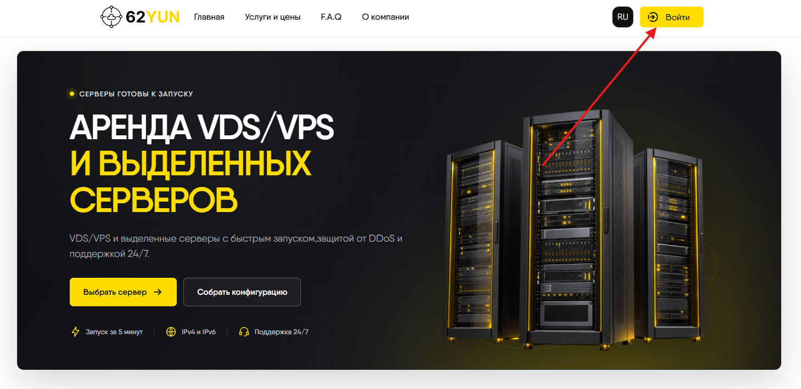

* Затем в модальном окне нажимаем "Регистрация"

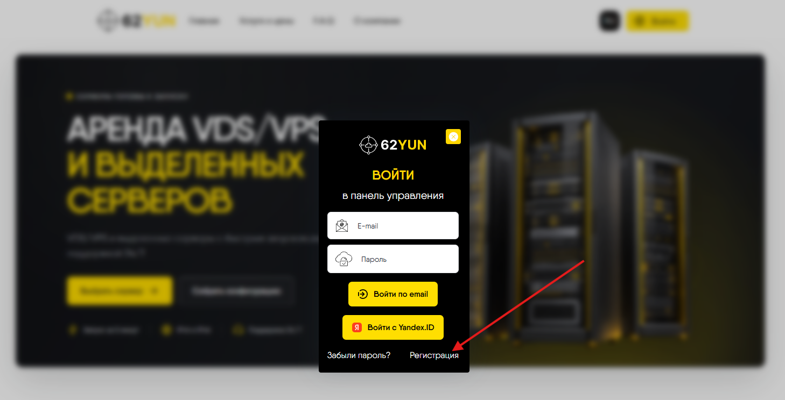

* В появившемся окне вводим свой действующий e-mail (ящики с proton.me вполне подходят).
Придумываем пароль и повторяем. После этого нажимаем кнопку "Зарегистрироваться"

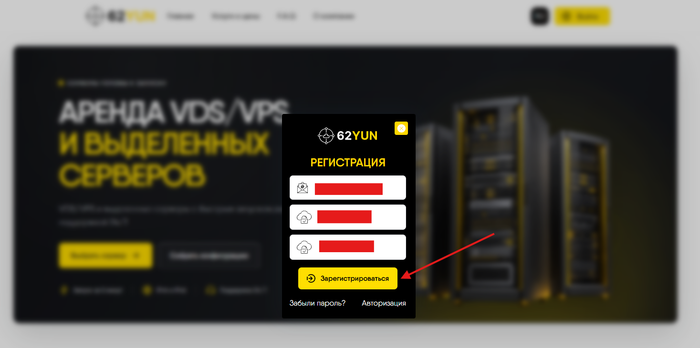

* Подтверждаем свой e-mail. На главной странице переходим в свой профиль

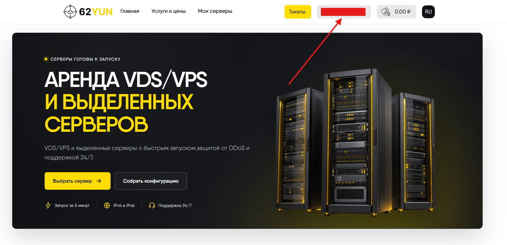

И нажимаем кнопку "Подтвердить".

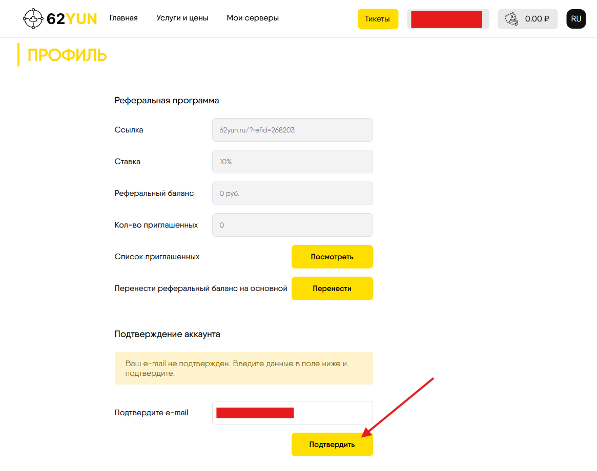

В модальном окне вводим код из письма

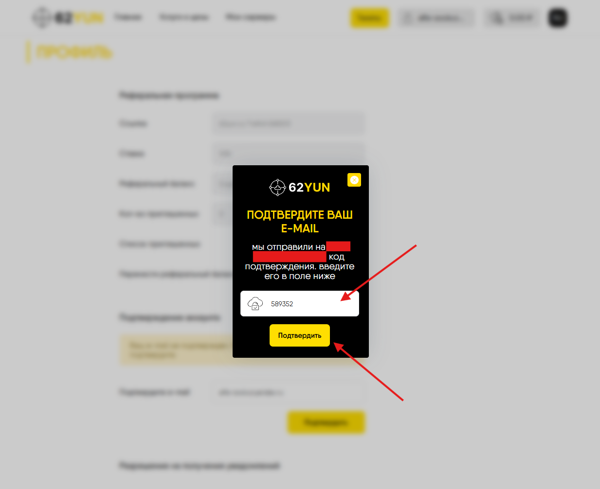

После этого появляется подтверждение

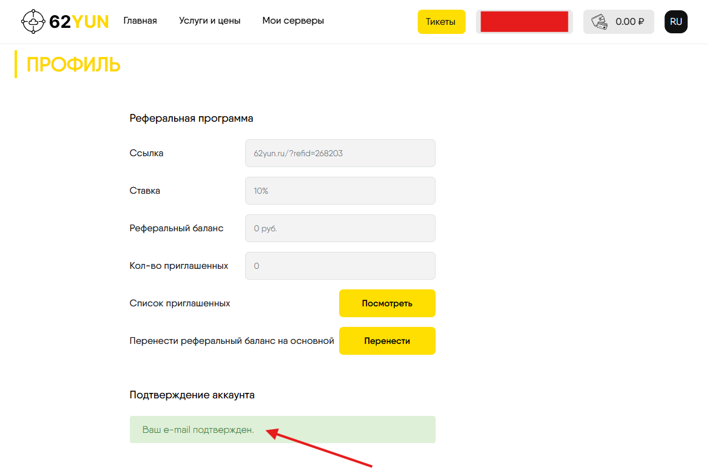

### Пополнение баланса и аренда сервера

Для начала выясним сколько стоит аренда сервера. Переходим на страницу "Мои серверы"


И нажимаем кнопку "Заказать Сервер"

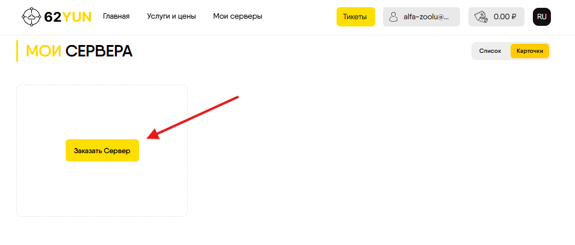

В "Локации" выбираем "Кремниевая долина (США)".
В Тарифах выбираем "promo-s" — его для работы одного прокси-сервера будет достаточно.
В ОС выбираем Ubuntu 24.04 LTS

И нажимаем кнопку "Заказать"

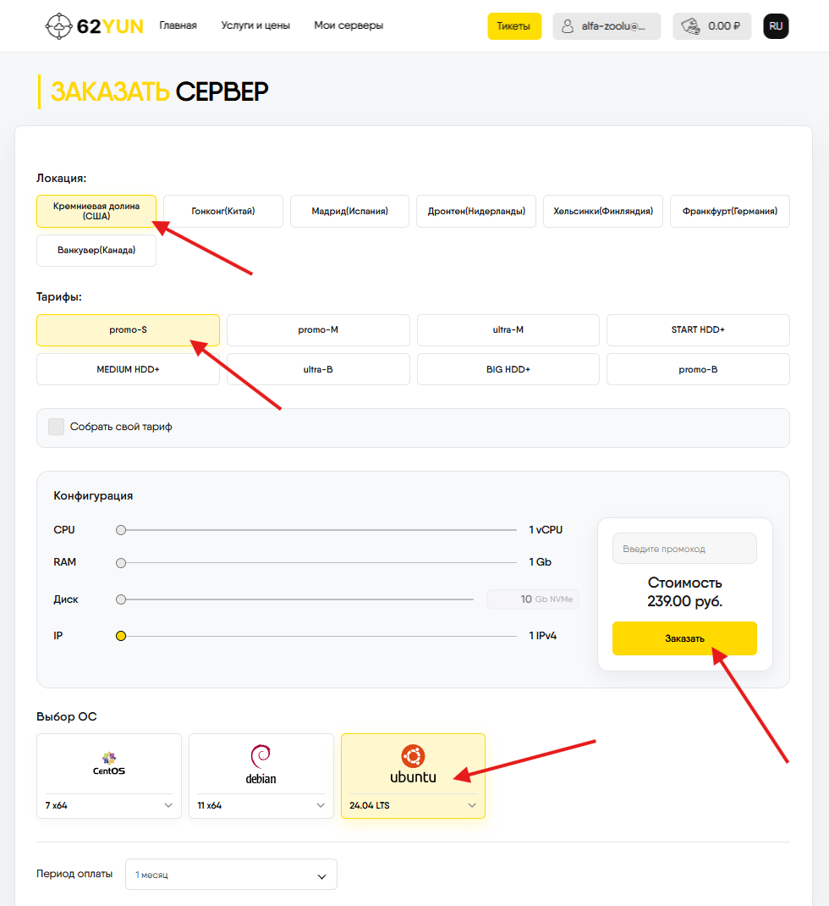

Сначала получаем сообщение, что средств недостаточно, а потом попадаем на страницу оплаты.
В поле "Сумма" уже будет стоять месячная аренда. Нажимаем "Продолжить".

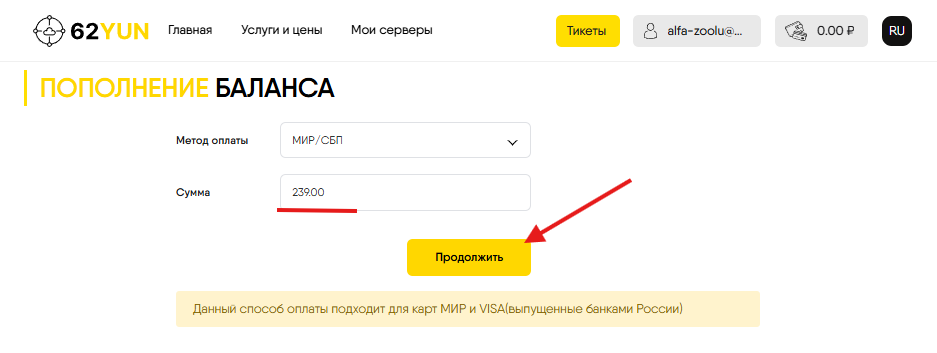

Дальше попадаем на страницу оплаты, где вводим данные своей карты и подтверждаем оплату.

После подтверждения оплаты на странице ["Мои серверы"](https://62yun.ru/servers/index)
должен появиться сервер. Если по какой-то причине сервер не появился, то нажимаем кнопку "Заказать и повторяем действия".
Пополнять баланс уже не нужно будет.

Нажимаем кнопку "Подробнее" и переходим к параметрам сервера.

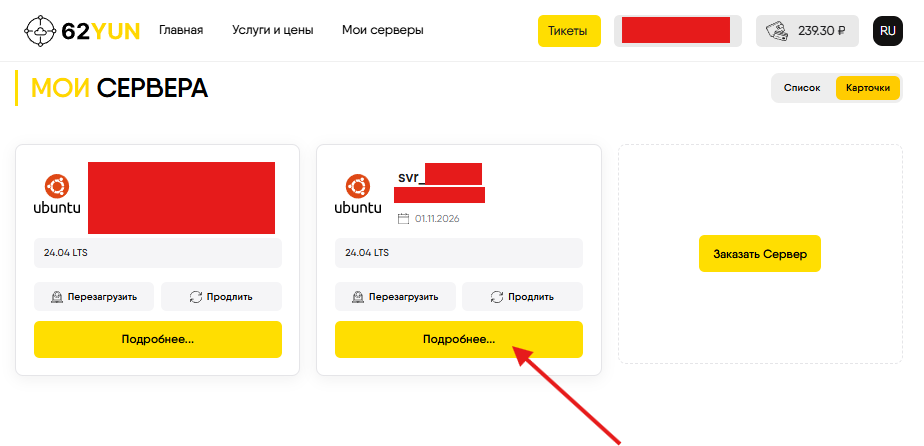

На этой странице сохраняем себе в Блокнот ip-адрес и пароль пользователя root


## Настройка прокси-сервера

Будем устанавливать и настраивать VPN-сервер AmneziaWG.

Для установки будем использовать скрипт из репозитория [github.com/bivlked/amneziawg-installer](https://github.com/bivlked/amneziawg-installer).


Большое спасибо автору))

### Настройка удаленного подключения к серверу

Можно пользоваться разными способами подключения — можно подключиться из терминала, можно использовать PuTTY или что-то
другое.

Я буду использовать программу MobaXterm


Качаем [архив](https://download.mobatek.net/2652026082870834/MobaXterm_Portable_v26.5.zip)
с официального сайта разработчика (бесплатную portable-версию).

Разархивируем его куда-нибудь на диск C. И запускаем программу.

В окне программы создаем новое подключение

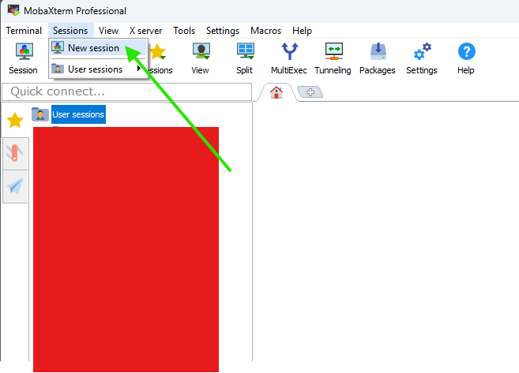

В появившемся окне создаем SSH-подключение

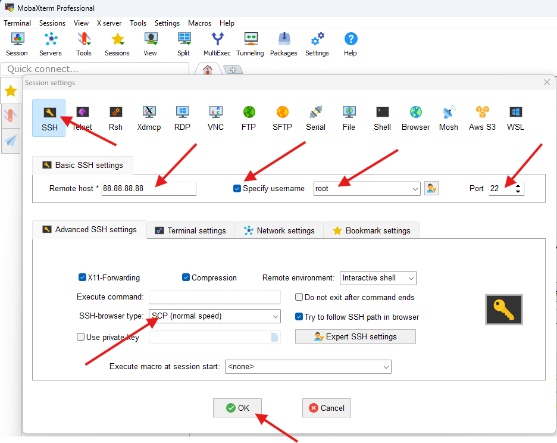

Указываем ip-адрес нашего сервера, имя пользователя root, порт 22.

На вкладке "Advanced SSH settings" в SSH-browser type выбираем SCP (normal speed)  и нажимаем кнопку "OK".

После подключения в строке терминала вводим пароль, который ранее сохранили в Блокнот.

### Настройка сервера

Настроим защиту сервера. Отключим вход по паролю, создадим приватный ключ и будем подключаться с приватным ключом.

* Создадим приватный ключ. В терминале вводим команду

```
ssh-keygen
```

При генерации ключей будут запрошены:

1. Имя файла ключа. Нажимаем Enter.
2. Пароль для ключа. Можно зашифровать, можно оставить не шифрованным. Я нажму Enter, не буду устанавливать пароль. И подтверждаю пароль.

В директории /root/.ssh/ появятся два файла:

1. id_ed25519 — приватный ключ
2. id_ed25519.pub - публичный ключ

Приватный ключ сохраню себе на компьютер — браузере перехожу в директорию /root/.ssh/
и перетаскиваю мышкой файл id_ed25519 в окно Проводника.

* Добавим в публичный ключ в список разрешенных

````
cat /root/.ssh/id_ed25519.pub > /root/.ssh/authorized_keys
````

Теперь мы должны иметь возможность подключаться к серверу с приватным ключом.

Закрываем подключение

```
exit
```

В программе MobaXterm нажимаем правой кнопкой мыши на нашем подключении и выбираем ``Edit session``

На вкладке ``Advanced SSH settings`` включаем опцию  ``Use private key`` и указываем на файл приватного ключа,
который ранее скопировали. Нажимаем ``OK``.

Теперь подключение должно произойти без запроса пароля.

* Если подключение без запроса пароля произошло, то будем отключать возможность удаленного входа по паролю.

В терминале вводим команду

```
 echo "PasswordAuthentication no" >> /etc/ssh/sshd_config
```

И перезапустим ``ssh``

```
systemctl restart ssh
```

Всё, теперь без приватного ключа никто не сможет подключиться. Позже заблокируем ботов,
которые перебирают пароли для доступа к серверу.

### Установка и настройка Amnezia WG

* Установка

В терминале вводим последовательно команды:

Переходим в домашнюю директорию

```
cd /root/
```

Скачиваем скрипт установки

```
wget -O install_amneziawg.sh https://github.com/bivlked/amneziawg-installer/releases/latest/download/install_amneziawg.sh
```

Делаем его исполняемым

```
chmod +x install_amneziawg.sh
```

Запускаем скрипт

```
sudo bash ./install_amneziawg.sh
```

В процессе установки скрипт запросит:

1. UDP порт для подключения клиентов (1-65535). Я выберу 585.
2. Внутреннюю подсеть туннеля. Оставлю по умолчанию 10.9.9.1/24
3. Отключение IPv6. Отключу.
4. Режим маршрутизации. Выберу 1 — весь трафик.
5. Изоляцию клиентов. Выберу блокировать трафик между клиентами.
6. Имя сервера. Оставлю AWG Server.
7. Удаление лишних пакетов. Соглашусь с удалением пакетов. Если потом какие-нибудь потребуются, поставлю самостоятельно.

В процессе установки сервер потребует две перезагрузки. Перезагрузка сервера будет длиться 2-3 минуты.
После перезагрузки нужно будет заново подключиться к серверу и возобновить работу скрипта командой

```
sudo bash ./install_amneziawg.sh
```

После второй перезагрузки будет предложено включить ``ufw`` — файервол. Включу его введя ``y``.
В процессе включения нужно будет подтвердить, что SSH использует именно 22 порт.

Будет установлен для защиты ``fail2ban``, он будет блокировать адреса с которых пытались подключиться удаленно
с неправильными учетными данными.

* Удалим автоматически созданных клиентов.

Переходим в директорию ``/root/awg/``

```
cd /root/awg/
```

Удаляем автоматически созданные конфигурации клиентов.

```
rm *.conf *.png *.vpnuri
```

Открываем файл ``/etc/amnezia/amneziawg/awg0.conf`` в редакторе и удаляем все строки, которые идут ниже строки, которая
начинается с ``I1 = ...``

* Создаем новых клиентов

Выполняем команду

```sudo bash /root/awg/manage_amneziawg.sh add catherine-mobile --psk```

Будет создан пользователь ``catherine-mobile``.
Создавайте для пользователя для каждого своего устройства.
Например, ``catherine-tablet``, ``catherine-laptop``, ``catherine-desktop`` —
два одинаковых пользователя не смогут подключиться к этому серверу.

То есть нужно будет выполнить команды:

```sudo bash /root/awg/manage_amneziawg.sh add catherine-tablet --psk```

```sudo bash /root/awg/manage_amneziawg.sh add catherine-laptop --psk```

```sudo bash /root/awg/manage_amneziawg.sh add catherine-desktop --psk```

Всё, пользователи готовы.

* Копируем к себе на компьютер файлы из директории ``/root/awg/``:

1. ``catherine-mobile.conf``
2. ``catherine-tablet.conf``
3. ``catherine-laptop.conf``
4. ``catherine-desktop.conf``

### Установка клиента на компьютер

Будем устанавливать ``Amnezia VPN client``.

Переходим в [репозиторий](https://github.com/amnezia-vpn/amnezia-client/releases/latest) и скачиваем
клиент для своей платформы в разделе ``Assets``.

Клиенты есть для разных платформ:
1. Android
2. Linux
3. MacOSX
4. Windows

Скачиваем клиент для [Windows](https://github.com/amnezia-vpn/amnezia-client/releases/download/5.0.3.0/AmneziaVPN_5.0.3.0_windows_x64.exe)
и запускаем установку

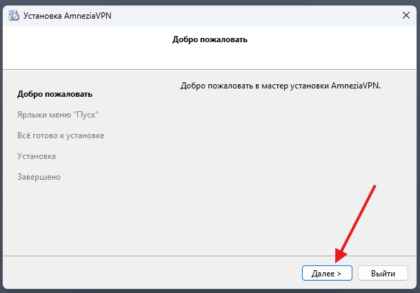

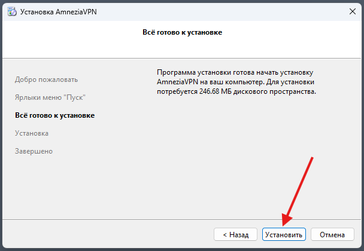

По окончании установки запустится клиент. Нажимаем кнопку ``Файл с настройками подключения``
и выбираем файл конфигурации. Например, ``catherine-desktop.conf``, который скачали ранее.

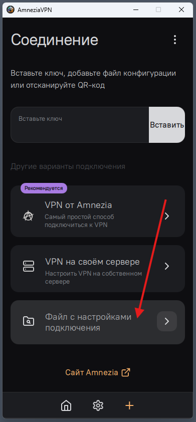

Нажимаем кнопку ``Подключиться``

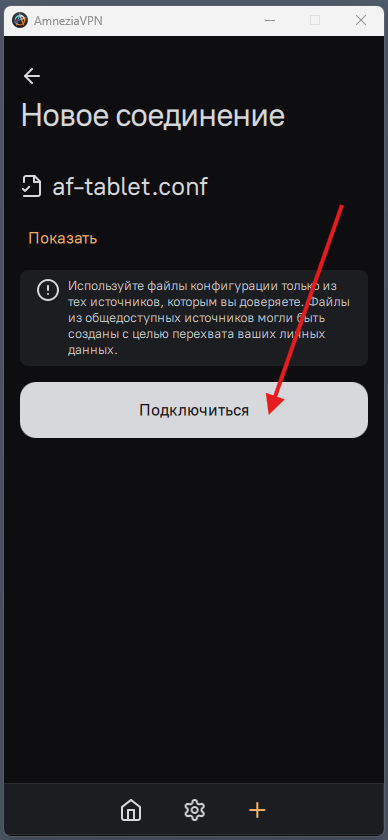

И еще раз нажимаем большую кнопку ``Подключиться``

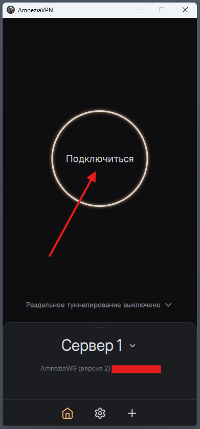

После успешного подключения должна появится надпись ``Подключено``

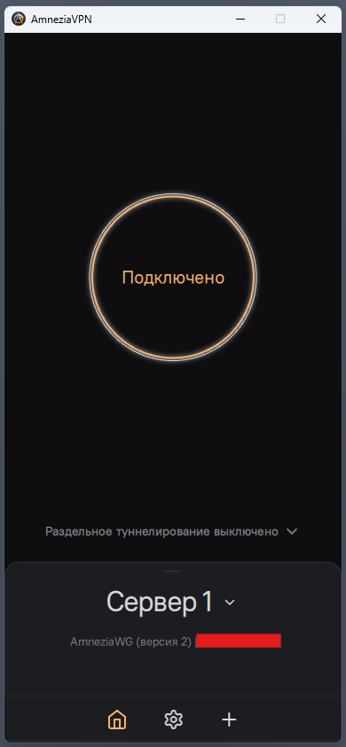

* Проверяем, что трафик действительно идет через VPN-сервер

Идем в любой браузер компьютера и переходим на [страницу](https://whoer.net/ru) проверки ip-адреса

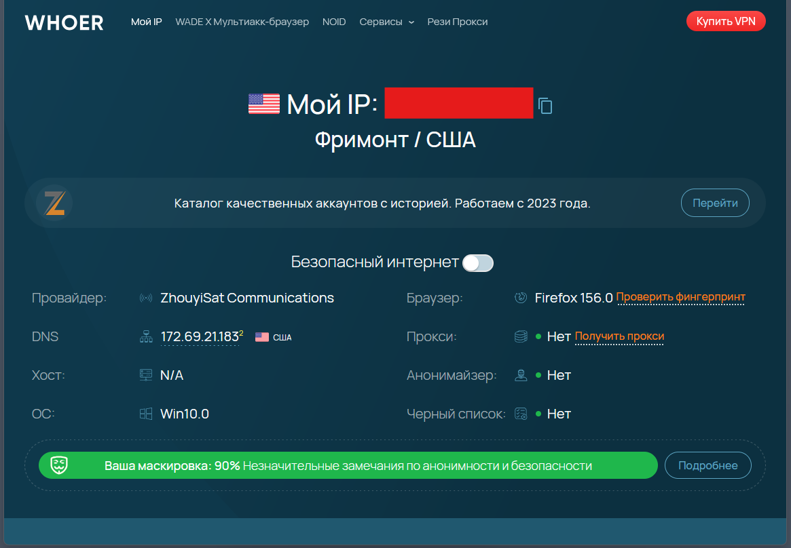

Сервис должен определить, что наш ip-адрес американский!

## Создание Google-аккаунта

В браузере переходим на страницу [google.com](https://www.google.com/) и нажимаем кнопку ``Sing in``

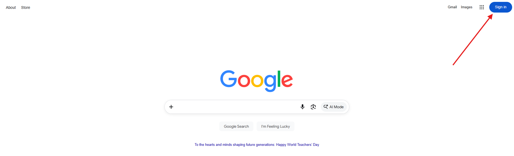

Нажимаем кнопку ``Create account`` из меню выбираем ``For my personal use``

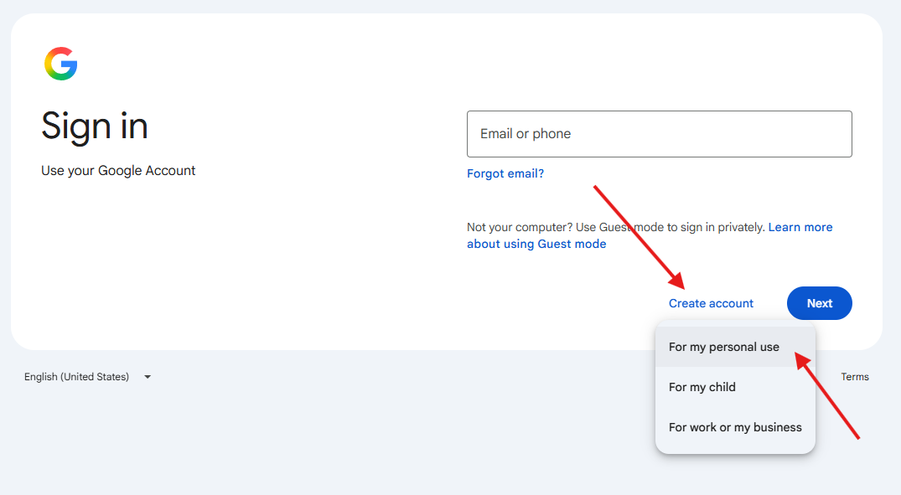

Вводим имя в поле ``First name`` и нажимаем кнопку ``Next``

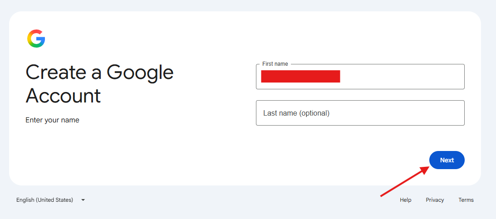

Вводим дату рождения и пол (пол можно не указывать). Нажимаем кнопку ``Next``

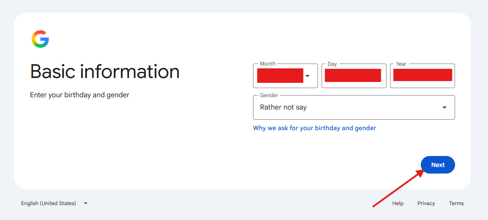

Если ни одно из предложенных имен не нравится, можно выбрать свое и нажать кнопку ``Next``

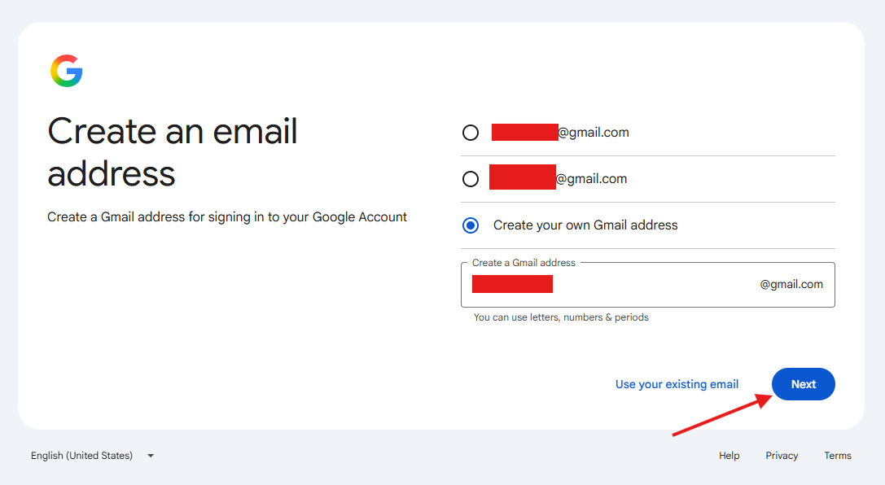

На следующем шаге нужно ввести пароль (комбинацию букв, цифр и символов), повторить его и нажать кнопку ``Next``

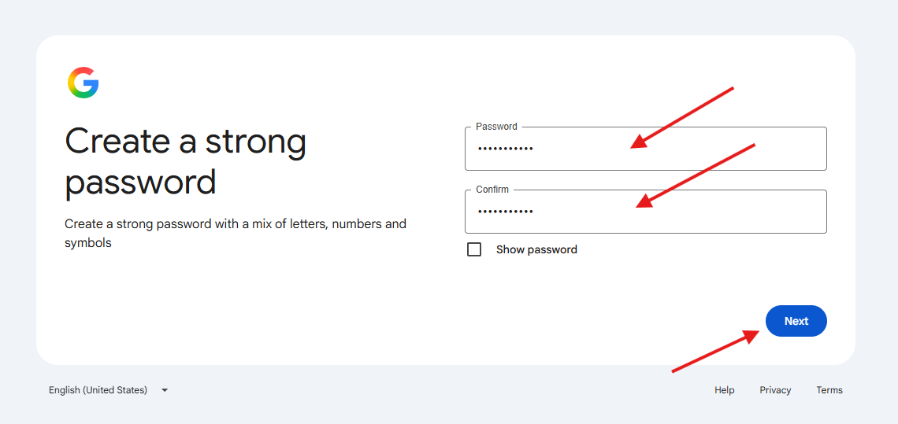

После этого сканируем камерой QR-код

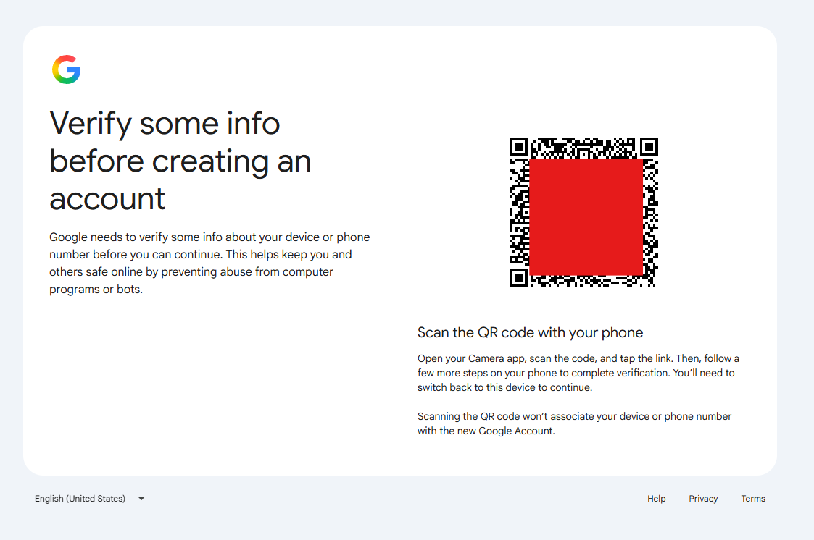

И подтверждаем на телефоне

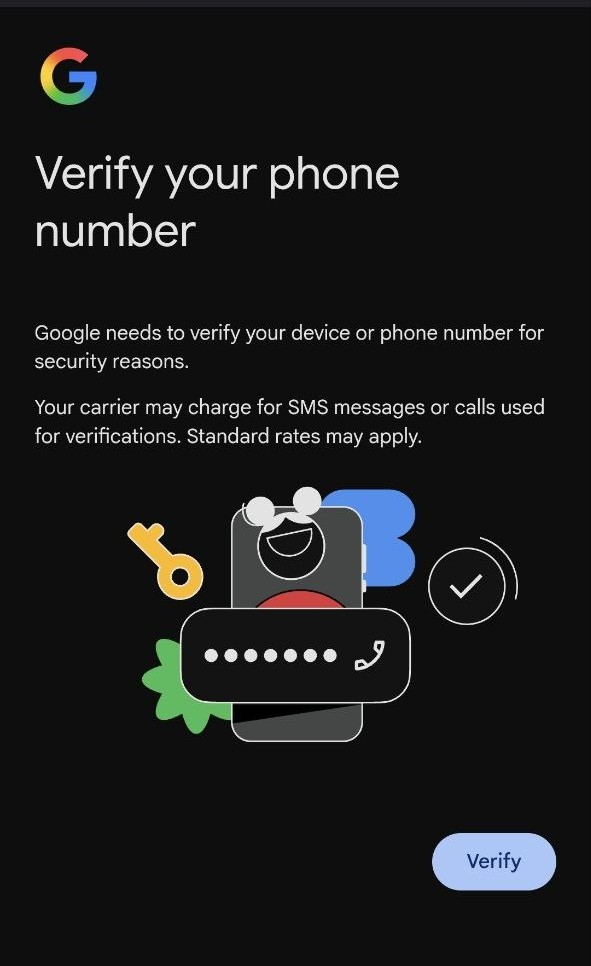

Потом, после успешного создания аккаунта, попросят ввести контакты для восстановления.
Телефон не буду указывать, а резервную почту укажу на сервере ``proton.me``. Нажимаем кнопку ``Save`` 

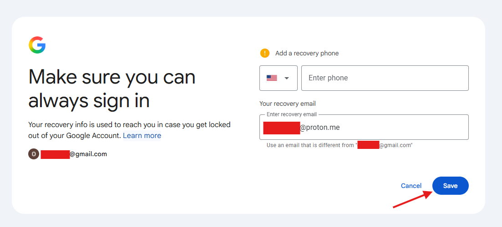

Дальше попросит указать домашний адрес. Пропускаем этот шаг. Нажимаем кнопку ``Skip``

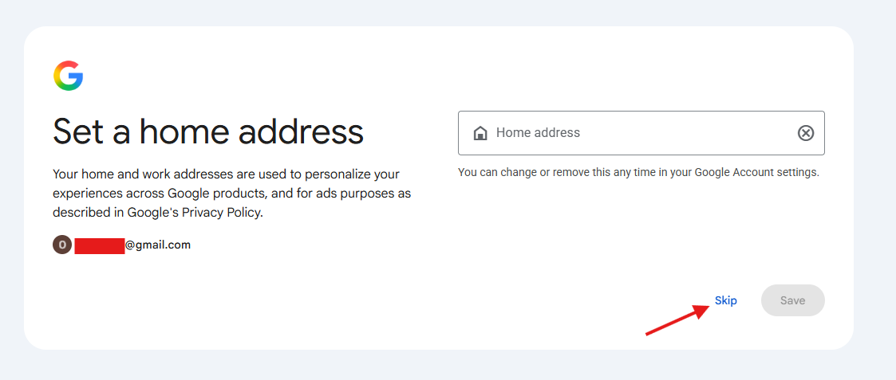

Всё. Гугл аккаунт создан.

## Установка приложения ``ChatGPT``

Переходим на страницу [загрузок](https://chatgpt.com/ru-RU/download/) и нажимаем
кнопку ``Скачать для Windows``

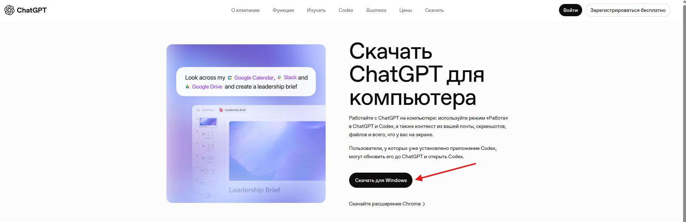

После окончания загрузки. Запускаем скачанный файл установщика. Начнется долгое скачивание приложения из
Microsoft Store

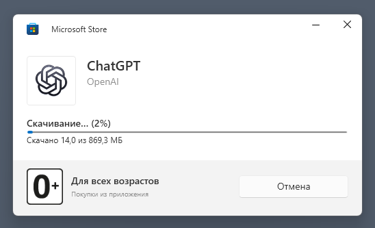


